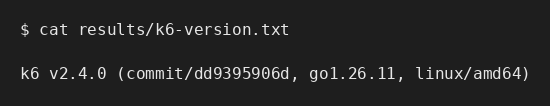
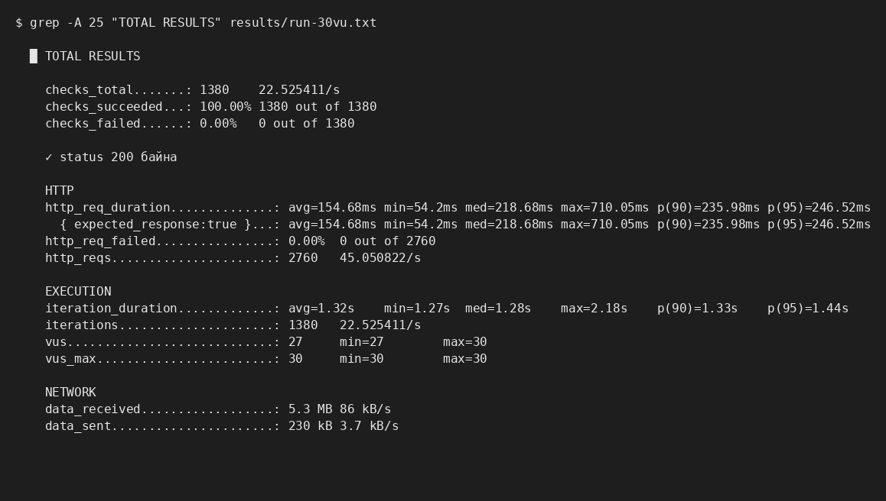
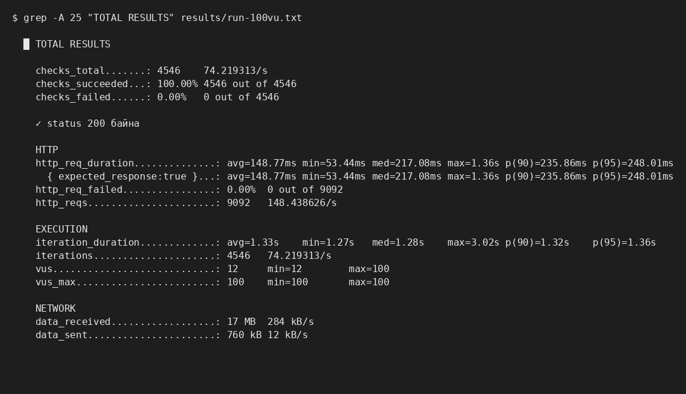
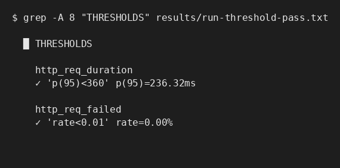
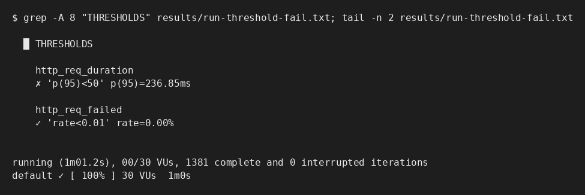
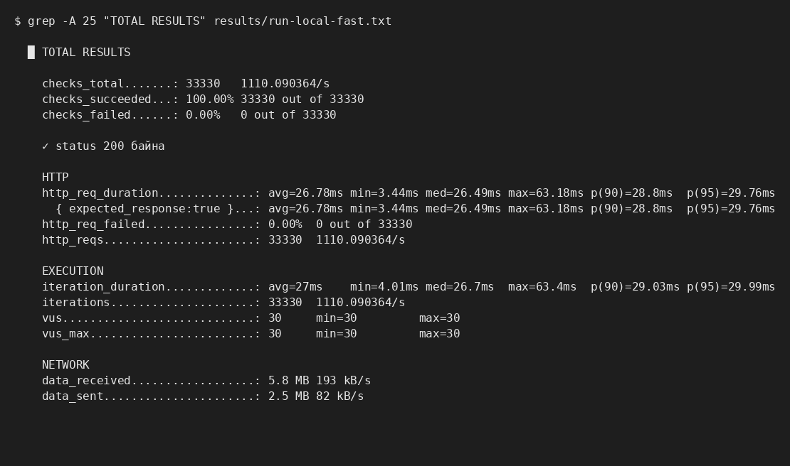
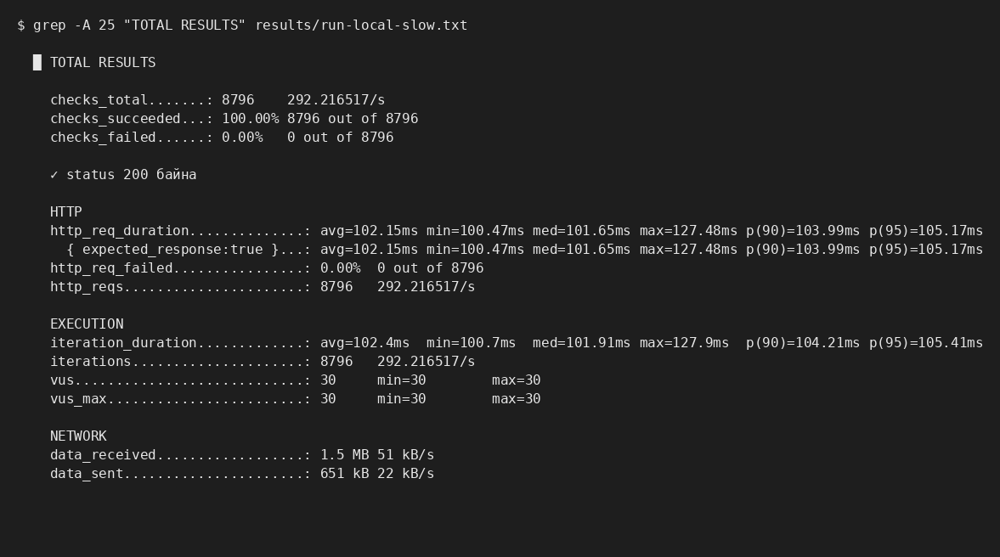

# k6 ачааллын тест (Лаб 2)

Энэ лабораторид k6 ашиглан гадаад сайт (https://test.k6.io) болон өөрийн бичсэн локал Flask сервер дээр ачааллын тест хийлээ. Бүх хэмжилтийн бүтэн гаралт `results/` хавтсанд, README дээрх тоонууд тэдгээр файлаас авсан.

## Ажлын орчин

WSL2 дээрх Ubuntu ашигласан. k6-ийн хувилбар (`results/k6-version.txt`):

```
k6 v2.4.0 (commit/dd9395906d, go1.26.11, linux/amd64)
```

k6-г анх зааврын GPG түлхүүрээр суулгахад алдаа гарсан (түлхүүр танигдаагүй). Тиймээс `https://dl.k6.io/key.gpg`-ийг татаж `gpg --dearmor`-оор хөрвүүлээд суулгасан.

## Файлууд

| Файл | Юу вэ |
|---|---|
| `script.js` | Үндсэн скрипт. `--vus` ба `--duration`-ээр дарж ажиллуулсан |
| `script-stages.js` | Ачааллыг шатлан өсгөдөг хувилбар |
| `script-threshold.js` | SLO threshold-той хувилбар |
| `script-threshold-fail.js` | Threshold-ыг санаатай хатуу болгосон (`p(95)<50`) хувилбар |
| `server.py`, `script-local.js` | Локал Flask сервер ба түүний тест |
| `make_screenshots.py` | `results/*.txt`-ээс зураг үүсгэдэг скрипт |
| `results/` | k6-ийн бүтэн текст гаралтууд |
| `screenshots/` | Гаралтын зургууд |

## Алхам 2: Анхны тест, baseline

Эхлээд `k6 run script.js` (5 VU, 30 секунд) ажиллуулсан. Энэ бол урьдчилсан туршилт (`results/run-05vu-30s.txt`): avg 143.69 ms, p90 231.21 ms, p95 232.65 ms, 7.455 req/s, алдаа 0%.

Баримтлах baseline-аа 5 VU-ийн 1 минутын хэмжилтээс авсан (`results/run-05vu.txt`): **p95 = 237.41 ms**. SLO-г энэ тоо дээр тулгуурлан гаргасан.

Анхаарсан зүйл: test.k6.io redirect хийдэг учраас нэг `http.get` нь 2 хүсэлт болж тоологддог. Жишээ нь 5 VU дээр 230 iteration, 460 http_reqs гарсан. Throughput-ийг `http_reqs`-ийн секундэд ногдох тоогоор бичсэн.

## Алхам 3: 5 / 30 / 100 VU

Түвшин бүрийг тусад нь 1 минут ажиллуулсан:

```
k6 run --vus 5 --duration 1m script.js | tee results/run-05vu.txt
k6 run --vus 30 --duration 1m script.js | tee results/run-30vu.txt
k6 run --vus 100 --duration 1m script.js | tee results/run-100vu.txt
```

| VU | avg | p90 | p95 | max | http_reqs | Throughput (req/s) | Iterations/s | Алдаа |
|---|---|---|---|---|---|---|---|---|
| 5 | 146.1 ms | 231.79 ms | 237.41 ms | 280.38 ms | 460 | 7.58 | 3.79 | 0.00% |
| 30 | 154.68 ms | 235.98 ms | 246.52 ms | 710.05 ms | 2760 | 45.05 | 22.53 | 0.00% |
| 100 | 148.77 ms | 235.86 ms | 248.01 ms | 1.36 s | 9092 | 148.44 | 74.22 | 0.00% |

Гурван ажиллуулалтад `checks` 100% амжилттай байсан.

### Stages (`results/run-stages.txt`)

5 → 30 → 100 → 0 VU гэж шатлан ажиллуулсан. Нэг ажиллуулалт ганц нэгтгэсэн summary өгдөг тул 5/30/100 тус бүрийг салгаж чадахгүй, иймээс хүснэгтэд оруулаагүй. Ерөнхий зургийг харахад: avg 147.01 ms, p90 230.88 ms, p95 236.1 ms, max 963.14 ms, нийт 7026 хүсэлт (46.57 req/s), алдаа 0%. Ачаалал өсөх, буурах үе орсон тул дундаж throughput нь тогтмол 100 VU-ийнхаас бага гарсан.

## Алхам 4: SLO ба thresholds

SLO:

- `http_req_duration`: `p(95)<360` ms
- `http_req_failed`: `rate<0.01` (1%-иас бага)

Үндэслэл: baseline p95 нь 237.41 ms. Үүнийг 1.5-аар үржүүлбэл ойролцоогоор 356 ms гарах тул 360 ms болгож дугуйлсан. Ингэвэл сүлжээний энгийн хэлбэлзэл тестийг унагахгүй, харин baseline-аас 50%-иас илүү удааширвал мэдэгдэнэ. Хэмжилтэд алдаа 0% байсан тул 1% гэсэн босго бодитой гэж үзсэн.

| Скрипт | Threshold | Хэмжсэн | Үр дүн |
|---|---|---|---|
| `script-threshold.js` (30 VU, 1м) | `p(95)<360` | 236.32 ms | PASS |
| `script-threshold.js` | `rate<0.01` | 0.00% | PASS |
| `script-threshold-fail.js` | `p(95)<50` | 236.85 ms | FAIL |
| `script-threshold-fail.js` | `rate<0.01` | 0.00% | PASS |

FAIL үед k6 төгсгөлд `thresholds on metrics 'http_req_duration' have been crossed` гэж мэдээлсэн. CI дээр quality gate яг ийм байдлаар pipeline-ийг унагадаг. Гаралтууд: `results/run-threshold-pass.txt`, `results/run-threshold-fail.txt`.

## Алхам 5: Локал сервер

`server.py` дотор хоёр endpoint бичсэн: `/fast` шууд хариулна, `/slow` 100 ms `sleep` хийнэ. Тус бүрийг 30 VU-ээр 30 секунд ачаалсан.

| Endpoint | avg | p90 | p95 | max | http_reqs | Throughput (req/s) | Алдаа |
|---|---|---|---|---|---|---|---|
| `/fast` | 26.78 ms | 28.8 ms | 29.76 ms | 63.18 ms | 33330 | 1110.09 | 0.00% |
| `/slow` | 102.15 ms | 103.99 ms | 105.17 ms | 127.48 ms | 8796 | 292.22 | 0.00% |

Гаралтууд: `results/run-local-fast.txt`, `results/run-local-slow.txt`.

## Дүгнэлт

1. Гадаад сайт дээр VU-г 5-аас 100 болгоход throughput 7.58 → 45.05 → 148.44 req/s болж, VU-ийн тоотой бараг пропорциональ өссөн.
2. Харин p95 нь 237.41 → 246.52 → 248.01 ms гэж бараг өөрчлөгдөөгүй, алдаа бүх түвшинд 0% байсан.
3. Тиймээс лекц дээр үзсэн "хэрэглэгч нэмэгдэхэд latency огцом муудна" гэсэн зөрчлийг энэ сайт дээр 100 VU хүртэл p95-аар олж харсангүй, test.k6.io энэ ачааллыг тэсвэрлэсэн.
4. Муудсан нь tail latency: max нь 280 ms → 710 ms → 1.36 s болж өссөн (stages дээр 963 ms). Тэгэхээр хэрэглэгчийн туршлага муудаж эхэлсэн цэг p95-аар биш, max-аар харахад 30 VU орчноос эхэлсэн.
5. `med` (~218 ms) нь `avg` (~150 ms)-ээс их байгаа нь хүсэлтүүд хоёр бүлэгт хуваагдаж байгааг харуулж байна. Redirect хурдан, эцсийн хуудас удаан байж магадгүй гэж таамагласан ч үүнийг тусад нь шалгаагүй.
6. Локал сервер дээр `/slow` нэмэхэд latency 26.78 → 102.15 ms болсон бол throughput 1110 → 292 req/s болж ойролцоогоор 3.8 дахин буурсан.
7. 30 VU ÷ 0.102 s ≈ 294 req/s бөгөөд хэмжсэн 292.22 req/s-тэй таарч байна. Энэ нь throughput ≈ зэрэгцээ хэрэглэгч ÷ latency (Little-ийн хууль) гэсэн холбоог баталж, лекцийн latency ба throughput-ийн харилцан хамаарлыг харуулсан.
8. Локал орчинд тархалт нарийн (`/slow`: p95 105 ms, avg 102 ms) байсан бол гадаад сайт дээр сүлжээний хэлбэлзэл нэмэгдэж байсан.
9. Тодорхойлсон SLO (p95 < 360 ms, алдаа < 1%) хангагдсан: p95 = 236.32 ms, алдаа 0%. Санаатай хатуу болгосон `p(95)<50` FAIL болж, quality gate ажиллаж байгааг батлав.
10. Хязгаарлалт: гадаад сайтын үр дүн цаг хугацаа, сүлжээнээс хамаарна. Мөн локал тестийн үед k6 болон Flask нэг машин дээр ажилласан тул нөөцийн төлөө өрсөлдсөн байж болзошгүй.

## Дэлгэцийн зураг

`screenshots/` доторх зургууд нь жинхэнэ дэлгэц барьсан зураг биш, `make_screenshots.py` скриптээр `results/*.txt` файлуудаас үүсгэсэн терминалын гаралтын зураг. Тиймээс тоонууд файлуудтай яг таарна.










